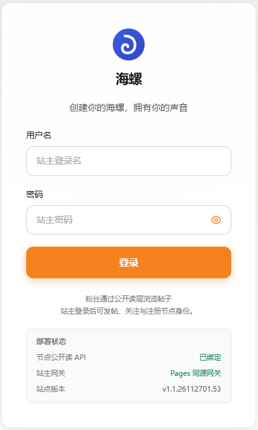
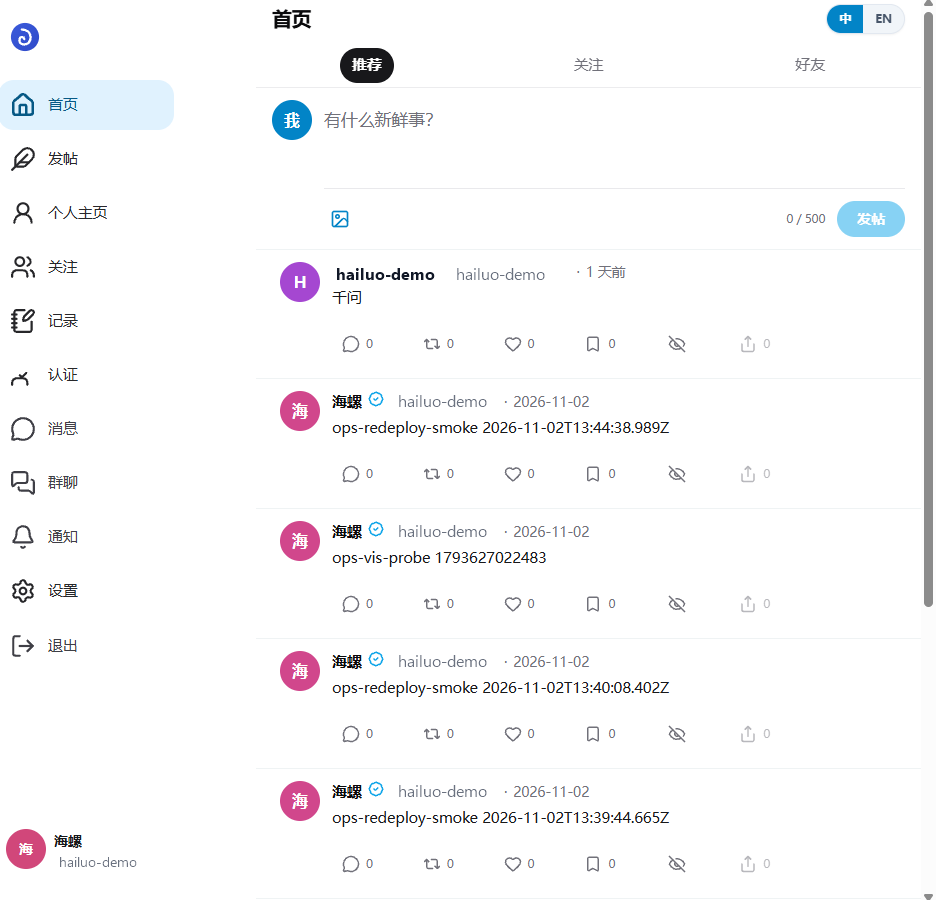

# Hailuo Node

[简体中文](./README.md) | **English**

> Run a decentralized social node in your own Cloudflare account: **Worker A (private write layer) + Worker B (public read layer) + Pages frontend**.
> All data stays in your Cloudflare account. The project maintainers cannot access it.

- **Worker A**: handles your posts, authentication, token issuance, and blocklists. Its public address is never exposed.
- **Worker B**: the only public read entry point for followers and other nodes (posts, images, follower tokens).
- **Web / Pages**: Astro + Preact frontend. Owner write requests go through Pages Functions + Service Binding back to Worker A.

> Detailed deployment and API documents are currently written in Chinese. English translations are welcome via PR.

---

## Screenshots





---

## Deployment

The first deployment must use **GitHub Actions**. It creates D1 / KV / Pages automatically, then deploys Worker A, Worker B, and the frontend. Button-based one-click deployments do not create these resources and will fail on the first run.

### Option 1: GitHub Actions

Fork this repository, configure the secret, then run **Deploy hailuo node** once in Actions:

1. **Fork** this repository to your account.

   > The two shortcuts below point to the upstream repository. After forking, replace `tsjworldcode/hailuome` in the URL with your own username and repository name.
   >
   > - [① Add the Cloudflare token to Secrets](https://github.com/tsjworldcode/hailuome/settings/secrets/actions/new)
   > - [② Run the workflow: Deploy Hailuo Node to Cloudflare](https://github.com/tsjworldcode/hailuome/actions/workflows/deploy.yml)

2. In `Settings → Secrets and variables → Actions`, add:

   | Secret | Required | Purpose |
   |---|---|---|
   | `CLOUDFLARE_API_TOKEN` | ✅ | Workers / D1 / KV / Pages edit permissions |
   | `CLOUDFLARE_ACCOUNT_ID` | Recommended | Required when the token can see multiple accounts; auto-detected otherwise |
   | `OWNER_SEED_USERNAME` | Optional | Owner login name for the first deployment |
   | `OWNER_SEED_PASSWORD` | Optional | Owner password for the first deployment (defaults are used if omitted; change it right after logging in) |
   | `WORKER_SECRETS_JSON` | Optional | Custom Worker secrets as a JSON object |
   | `REGISTRY_URL` | Optional | Override the default registry URL |

3. Open [`Actions → Deploy hailuo node`](https://github.com/tsjworldcode/hailuome/actions/workflows/deploy.yml) → **Run workflow**, and wait for both jobs to turn green.

See **[docs/deploy-github-actions.md](./docs/deploy-github-actions.md)** for the full guide.

### Option 2: Local deployment

See **[docs/deploy.md](./docs/deploy.md)** and **[docs/部署指南.md](./docs/部署指南.md)**.

---

## Three things to know before deploying

1. **One node per Cloudflare account.** A node uses several D1 databases and KV namespaces. Sharing an account with the official registry will exceed the free tier.
2. **Never expose the Worker A address.** Do not put it in CORS, the registry, or the frontend. Only Worker B is public.
3. **Check the free-tier limits first.** Under the Cloudflare Free Tier, D1 allows 100,000 writes/day and KV allows 1,000 writes/day. This project is designed around those limits (counters, rate limits, and sessions all use D1).

---

## Repository layout

```text
apps/worker-a/     # Private write layer: posts, follows, tokens, blocklists, Cron
apps/worker-b/     # Public read layer: posts, images, follower tokens, federation reads
web/               # Astro + Preact frontend; functions/ is the owner write gateway
packages/          # Shared libraries: crypto / types / utils / otel / registry-protocol
scripts/           # Deployment and gate scripts
docs/              # Deployment, API contracts, troubleshooting
```

## Local development

```bash
npm ci
npm run typecheck
npm run dev:worker-a     # default port 8787
npm run dev:worker-b     # default port 8788
npm run dev:web          # default port 4321
```

Apply D1 migrations locally:

```bash
npm exec -- wrangler d1 migrations apply IDENTITY_DB --local --config apps/worker-a/wrangler.toml
```

## Deployment contract checks

The public repository ships four read-only checks that never call Cloudflare:

```bash
npm run test:deploy-github-actions
npm run test:ed25519-key-consistency
npm run test:deploy-config-consistency
npm run audit:deploy-shell-hazards
```

## Security and privacy

- Worker A is never public. Followers and other nodes read only from Worker B.
- Direct messages and group chats are end-to-end encrypted. The server only forwards and stores ciphertext.
- Logs and examples never contain real IP addresses, email addresses, tokens, or node handles.
- For security issues, read [SECURITY.md](./SECURITY.md) and report privately through GitHub Security. Do not open a public issue.

## Contributing

- Read [CONTRIBUTING.md](./CONTRIBUTING.md) before submitting.
- First-time PRs must confirm the [Contributor License Agreement (CLA)](./.github/CLA.md).
- For security issues, read [SECURITY.md](./SECURITY.md) first, then report privately through the repository's Security page. Do not open a public issue.

## License

This project is licensed under **AGPL-3.0-only**. See [LICENSE](./LICENSE) and [NOTICE](./NOTICE).

- Self-hosting, modification, and commercial use are allowed under the AGPL.
- If you run a modified version as a network service, you must offer the corresponding source to its users (AGPL §13).
- Closed-source commercial use or closed-source hosted services require a separate [commercial license](./COMMERCIAL_LICENSE.md).
