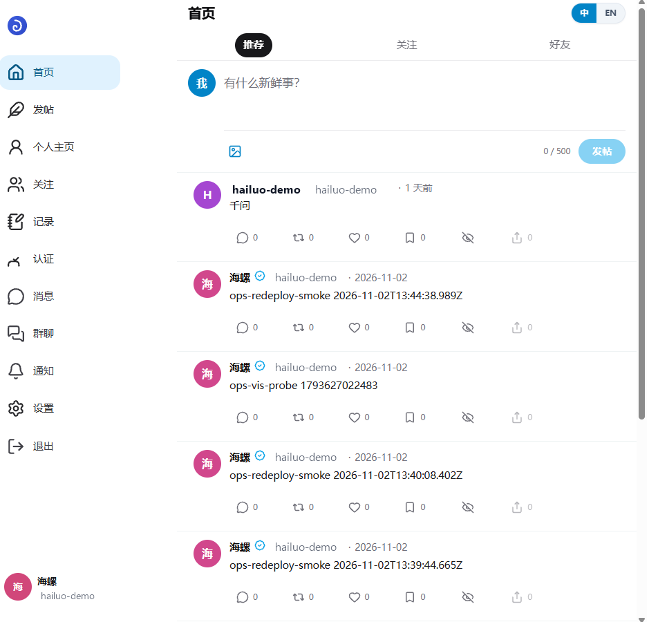

# 海螺节点（Hailuo Node）

[简体中文](./README.md) | [English](./README.en.md)

> 在自己的 Cloudflare 账号里跑一个去中心化社交节点：**Worker A（私密写层）+ Worker B（公开读层）+ Pages 前端**。
> 所有数据都在你自己的 Cloudflare 账号里，项目创建者无法访问。

- **Worker A**：只处理本人发帖、鉴权、Token 签发、黑名单；公网地址永不暴露。
- **Worker B**：粉丝和外部节点唯一的公开读入口（帖子、图片、粉丝 Token）。
- **Web / Pages**：Astro + Preact 前端，站主写请求经 Pages Functions + Service Binding 回到 Worker A。

---

## 界面预览




---

## 一键部署

首次部署请走 **GitHub Actions**：它会自动创建 D1 / KV / Pages，再部署 Worker A、Worker B 和前端。按钮式一键部署不会创建这些资源，首次部署会失败。

### 方式一：GitHub Actions

Fork 本仓库，配置 Secret，然后在 Actions 里点一次 **Deploy hailuo node**：

1. **Fork** 本仓库到你的账号。

   > 下面两个快捷入口指向上游仓库。Fork 后请把 URL 里的 `tsjworldcode/hailuome` 换成你自己的用户名和仓库名。
   >
   > - [① 将 Cloudflare Token 添加到 Secrets](https://github.com/tsjworldcode/hailuome/settings/secrets/actions/new)
   > - [② 运行工作流程：将海螺节点部署到 Cloudflare](https://github.com/tsjworldcode/hailuome/actions/workflows/deploy.yml)

2. 在 `Settings → Secrets and variables → Actions` 添加：

   | Secret | 必填 | 用途 |
   |---|---|---|
   | `CLOUDFLARE_API_TOKEN` | ✅ | Workers / D1 / KV / Pages 编辑权限 |
   | `CLOUDFLARE_ACCOUNT_ID` | 建议 | 多账号时必填，单账号可自动探测 |
   | `OWNER_SEED_USERNAME` | 可选 | 首次部署的站主登录名 |
   | `OWNER_SEED_PASSWORD` | 可选 | 首次部署的站主密码（不填则用默认值，登录后请立刻修改） |
   | `WORKER_SECRETS_JSON` | 可选 | 自定义 Worker Secret，JSON 对象 |
   | `REGISTRY_URL` | 可选 | 覆盖默认注册中心地址 |

3. 打开 [`Actions → Deploy hailuo node`](https://github.com/tsjworldcode/hailuome/actions/workflows/deploy.yml) → **Run workflow**，等两个 Job 变绿。

完整说明见 **[docs/deploy-github-actions.md](./docs/deploy-github-actions.md)**。

### 方式二：本地部署

见 **[docs/deploy.md](./docs/deploy.md)** 和 **[docs/部署指南.md](./docs/部署指南.md)**。

---

## 部署前需要知道的三件事

1. **一个节点一个 Cloudflare 账号**。节点会占用多个 D1 / KV；和官方注册中心放同一账号会超过免费额度。
2. **Worker A 地址不要外传**。它不写进 CORS、不写进注册中心、不写进前端；对外只有 Worker B。
3. **先看免费额度**。Cloudflare Free Tier 下 D1 写 10 万次/天、KV 写 1000 次/天，本项目已按这个上限设计（计数、限流、会话一律走 D1）。

---

## 目录结构

```text
apps/worker-a/     # 私密写层：发帖、关注、Token、黑名单、Cron
apps/worker-b/     # 公开读层：帖子、图片、粉丝 Token、外部节点读
web/               # Astro + Preact 前端；functions/ 是站主写层网关
packages/          # 共享库：crypto / types / utils / otel / registry-protocol
scripts/           # 部署与门禁脚本
docs/              # 部署、API 契约、排障
```

## 本地开发

```bash
npm ci
npm run typecheck
npm run dev:worker-a     # 默认 8787
npm run dev:worker-b     # 默认 8788
npm run dev:web          # 默认 4321
```

D1 migration 本地 apply：

```bash
npm exec -- wrangler d1 migrations apply IDENTITY_DB --local --config apps/worker-a/wrangler.toml
```

## 部署契约自检

公开仓带 4 条只读门禁，不访问 Cloudflare：

```bash
npm run test:deploy-github-actions
npm run test:ed25519-key-consistency
npm run test:deploy-config-consistency
npm run audit:deploy-shell-hazards
```

## 安全与隐私

- Worker A 永远不对外；粉丝和外部节点只读 Worker B。
- 私信与群聊内容端到端加密，服务端只做转发与存储。
- 日志与示例不写真实 IP、邮箱、Token、节点 handle。
- 发现安全问题请阅读 [SECURITY.md](./SECURITY.md)，通过 GitHub Security 页面私下报告，不要开公开 Issue。

## 参与贡献

- 提交前请阅读 [CONTRIBUTING.md](./CONTRIBUTING.md)。
- 首次 PR 需要在模板中确认 [贡献者许可协议（CLA）](./.github/CLA.md)。
- 安全问题请先阅读 [`SECURITY.md`](./SECURITY.md)，再通过仓库 Security 页面私密报告，不要开公开 Issue。

## License

本项目以 **AGPL-3.0-only** 开源，全文见 [LICENSE](./LICENSE) 与 [NOTICE](./NOTICE)。

- 自部署、修改、商用都可以，但必须遵守 AGPL。
- 把修改版作为网络服务提供时，要向该服务的用户提供对应源码（AGPL §13）。
- 闭源商用或闭源托管服务，需要单独取得[商业授权](./COMMERCIAL_LICENSE.md)。
